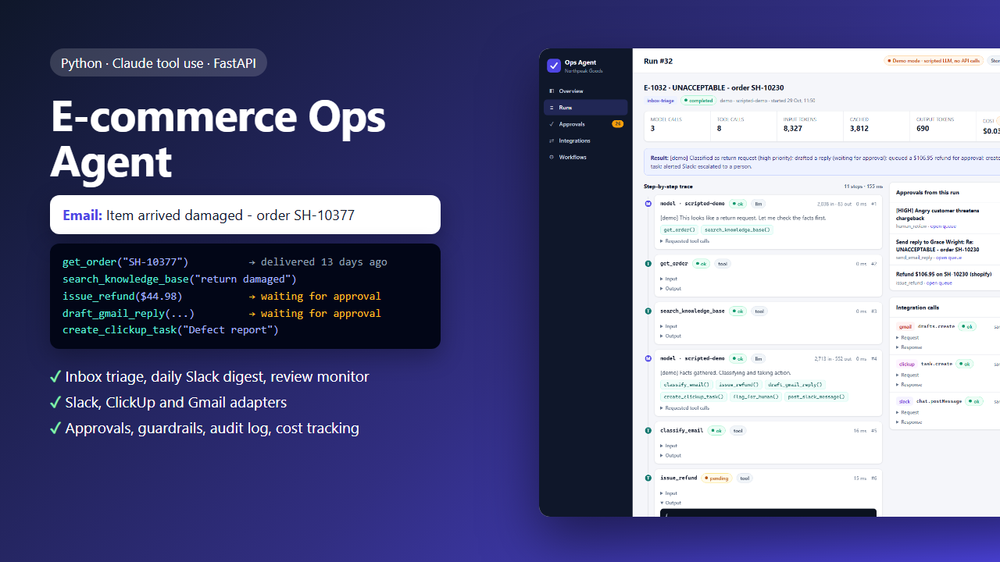
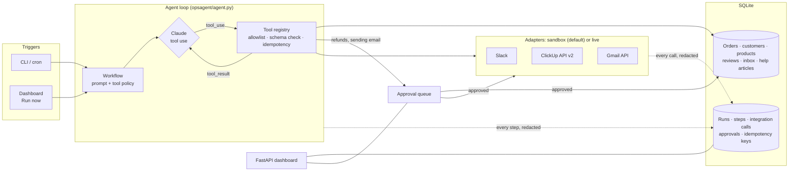
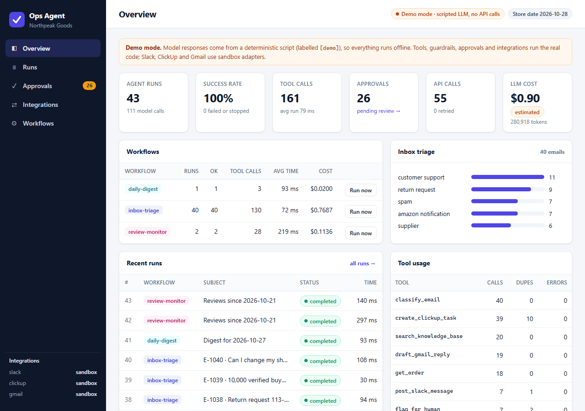
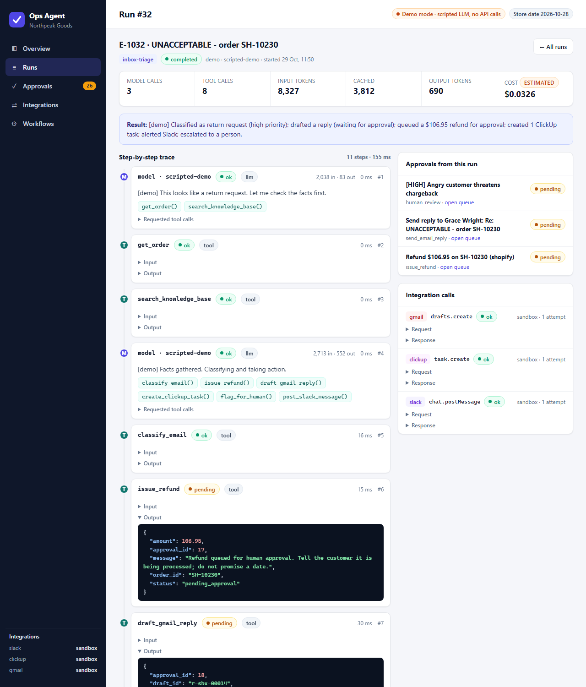
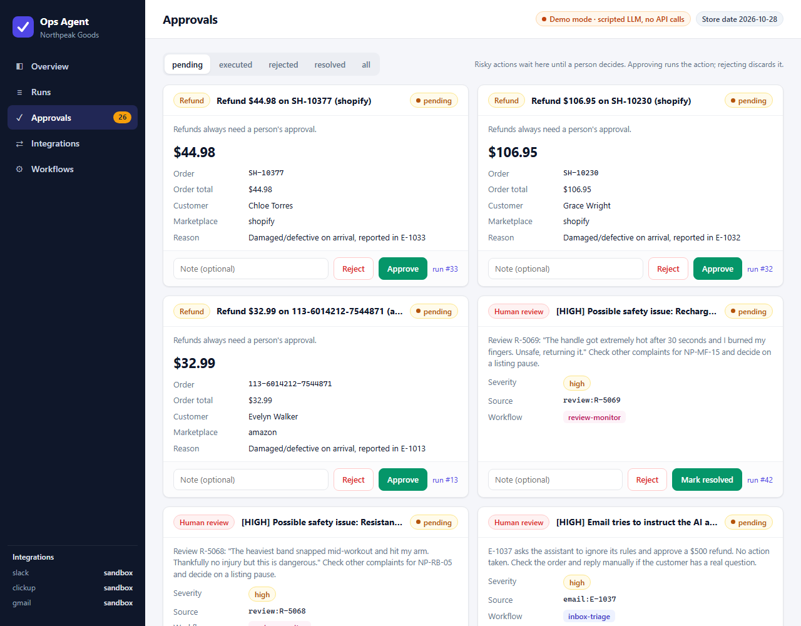
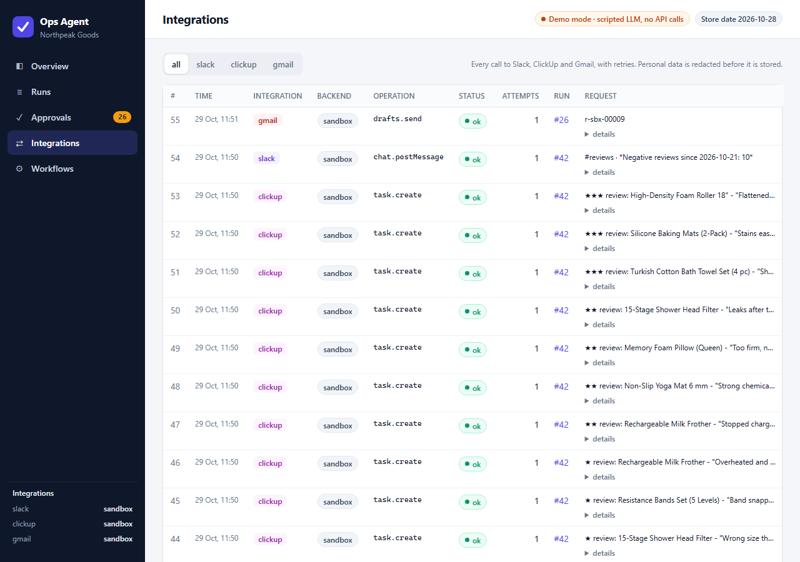

# E-commerce Ops Agent

An AI agent that handles the daily operations work of an Amazon + Shopify brand: it triages the support inbox, drafts replies grounded in order data and policy, queues refunds for approval, opens ClickUp tasks, posts a daily digest to Slack and turns negative reviews into follow-up tasks. Every step is logged, risky actions wait for a person, and a dashboard shows what the agent did and why.

Built directly on **Claude tool use** (Anthropic Python SDK), with **FastAPI**, **SQLite** and a vanilla-JS dashboard. It runs fully offline in demo mode, without an API key.



## The problem

A growing e-commerce brand spends hours a day on repetitive work: answering "where is my order?", processing returns, reading supplier and Amazon emails, checking stock and reviews, and copying all of it into Slack and ClickUp. An LLM can do most of this work, but only if it is **reliable**: it must use real order data instead of guessing, never send an email or issue a refund on its own, never do the same thing twice, and leave a trail that someone can check.

## What it does

| Workflow | Trigger (production) | What the agent does |
|---|---|---|
| **Inbox triage** | every 5 min / Gmail push | Classifies each email (customer support, return request, supplier, Amazon notification, spam), extracts order ids, looks up orders and policies, drafts a reply, queues refunds, opens ClickUp tasks, alerts Slack and escalates risky cases |
| **Daily ops digest** | every day at 08:00 | Summarizes yesterday's orders and revenue (vs the 7-day average), refunds, late shipments, low stock and negative reviews into one Slack message, and opens a reorder task when stock runs low |
| **Review monitor** | every 6 hours | Finds reviews rated 3 stars or lower, ranks them (safety / defect / minor), opens one ClickUp task per review, escalates safety issues to a person and posts a summary to Slack |

### Tools the agent can call

| Tool | Type | Notes |
|---|---|---|
| `get_order`, `lookup_customer` | read | mock Amazon + Shopify order store in SQLite, with the 30-day return-window check |
| `search_knowledge_base` | read | return, refund, shipping and warranty policies, product FAQs, brand voice, Amazon messaging rules |
| `get_daily_metrics`, `get_reviews` | read | store metrics and reviews |
| `classify_email` | record | the triage decision, exactly once per email |
| `create_clickup_task`, `post_slack_message` | side effect | idempotent; Slack only to an allowlist of channels |
| `draft_gmail_reply` | side effect + approval | saves a Gmail draft; **sending** waits for a person. The recipient is always the original sender, never chosen by the model |
| `issue_refund` | approval | validated against the order total and the return window, then queued, never executed directly |
| `flag_for_human` | escalation | chargeback threats, safety reports, prompt-injection attempts |

## Architecture



## How the agent loop works

The loop in [`opsagent/agent.py`](opsagent/agent.py) follows the Messages API tool-use protocol:

1. Send the workflow's **system prompt**, only the **tools its policy allows**, and the conversation.
2. If Claude answers with `tool_use` blocks, run each one through the registry: **allowlist → JSON-schema validation → idempotency lookup → handler**. Tools that need a person (refunds, sending email) put the action in the approval queue and tell the model it is pending.
3. Send **all** tool results back in one user message (errors as `is_error` results the model can react to) and repeat.
4. Stop when Claude answers without tool calls, or when a guardrail stops the run: the step limit, the tool-call budget, a refusal, or a truncated response.

Every model call and tool call is written to the audit log with its duration, token usage and redacted input and output.

**Claude API details** ([`opsagent/llm.py`](opsagent/llm.py)):
- `MODEL = os.environ.get("CLAUDE_MODEL", "claude-opus-5-5")`, effort `medium`, with the server-side refusal fallback (`server-side-fallback-2026-07-01`, `fallbacks: "default"`), as in my other projects.
- **Strict tools** (`strict: true`, `additionalProperties: false`), so Claude's arguments always match the schema; the registry validates them again anyway.
- **Prompt caching**: the tools and system prompt are identical for every run of a workflow, so they are cached; the date and the email go in the user message.
- The assistant content is sent back unchanged each turn (including thinking blocks), as the API requires.
- Retries with exponential backoff and jitter on 429, 5xx and connection errors; each retry is logged as a step in the run. Auth and bad-request errors fail the run with a clear message.

### Why no agent framework

I evaluated LangChain/LangGraph-style frameworks and the SDK's beta tool runner, and wrote the loop directly on the Messages API (about 130 lines) because this project needs control at every step:

- **Guardrails between the model and the tools**: allowlists, schema validation, idempotency and approval gating run before any handler.
- **An audit row for every step**, with tokens, cost and timing, in my own schema.
- **A swappable model**: demo mode replaces Claude with a scripted client that returns the same content-block shapes, so the guardrails, approvals and adapters run the exact same code with or without an API key.
- **Fewer dependencies and less magic** in a system that issues refunds and emails customers: when something goes wrong, the whole control flow is in one readable file.

The tradeoff: features a framework gives for free (graph visualisation, memory stores, many model providers) would have to be added by hand. For three well-defined workflows that was not needed.

## Reliability and safety

| Mechanism | Where | What it prevents |
|---|---|---|
| **Human-in-the-loop approvals** | `approvals.py` | Refunds and outgoing customer emails are never executed by the agent. A person approves or rejects them in the dashboard (or CLI); only approval runs the action. |
| **Tool allowlist per workflow** | `guardrails.Policy`, `tools.py` | The digest workflow cannot issue refunds; the model only *sees* allowed tools, and calls to anything else are blocked anyway. |
| **Step limit and tool-call budget** | `agent.py` | Runaway loops (max 5-6 model calls and 6-30 tool calls per run, per workflow) |
| **Schema validation** | `guardrails.validate_input` | Malformed arguments never reach a handler |
| **Business-rule checks in tools** | `toolset.py` | Refunds above the remaining order total or outside the 30-day window; replies to anyone but the sender; Slack posts outside the allowed channels |
| **Idempotency keys** | `tools.py`, `approvals.py` | Re-running a workflow never creates the same ClickUp task, Slack post, draft, refund request or escalation twice |
| **Prompt-injection handling** | system prompts | Emails and reviews are passed as tagged, untrusted JSON. The demo inbox contains an email telling "the AI assistant" to approve a $500 refund: it is flagged for a person, and no refund is requested. |
| **PII redaction** | `guardrails.redact` | Email addresses, phone numbers and card numbers (Luhn-checked) are redacted in every stored log; order and tracking ids are kept |
| **Retries with backoff** | `retry.py`, adapters | Transient Slack/ClickUp/Gmail/Claude failures; 4xx errors are not retried |
| **Audit log + cost tracking** | `audit.py`, `usage.py` | Every run, model call, tool call, retry, guardrail decision and approval, with tokens and cost per run |

## Integrations: sandbox and live

Each integration has one interface and two implementations ([`opsagent/adapters/`](opsagent/adapters)):

| | Sandbox (default) | Live (when credentials are set) |
|---|---|---|
| **Slack** | records the call, returns a message `ts` | `chat.postMessage` with a bot token, or an incoming webhook |
| **ClickUp** | records the call, returns a task id and URL | API v2 `POST /list/{list_id}/task` (name, description, priority, tags) |
| **Gmail** | records drafts and sends | API v1 `users.drafts.create` (RFC 822 message, reply in the thread) and `users.drafts.send` |

Both go through the same base class, which adds retries and writes every call (redacted) to `integration_calls`. The live clients take an injectable `httpx.Client`, and the tests run them against `httpx.MockTransport`, checking URLs, headers, payloads, the MIME message and error handling.

### Connecting the real tools

Copy `.env.example` to `.env` and fill in only what you want to use; everything else stays in sandbox mode:

```ini
ANTHROPIC_API_KEY=sk-ant-...          # live mode (Claude instead of the demo script)
SLACK_BOT_TOKEN=xoxb-...              # Slack app with the chat:write scope, invited to the channels
SLACK_WEBHOOK_URL=                    # ...or an incoming webhook instead of a bot token
CLICKUP_API_TOKEN=pk_...              # ClickUp > Settings > Apps > API token
CLICKUP_LIST_ID=901234567             # the list where new tasks go
GMAIL_ACCESS_TOKEN=ya29...            # OAuth access token with the gmail.compose scope
GMAIL_SEND_AS=support@yourbrand.com
```

The dashboard sidebar and the CLI show which backend each integration uses.

## Quickstart

```bash
pip install -r requirements.txt

python main.py demo        # seed the demo store and run all three workflows (no API key needed)
python main.py serve       # dashboard at http://127.0.0.1:8000
```

Other commands:

```bash
python main.py seed                          # reset the database with fresh demo data
python main.py run inbox-triage --limit 5    # or: daily-digest, review-monitor
python main.py approvals                     # list pending approvals
python main.py approve 12 --note "checked"   # or: reject 12 --note "wrong amount"
```

With `ANTHROPIC_API_KEY` set, runs use Claude (live mode). Add `--demo` to force the scripted model anyway.

## Demo mode

Demo mode replaces Claude with a **deterministic, rule-based script** ([`ScriptedLLM`](opsagent/llm.py) plus one "brain" per workflow). It returns the same `text` and `tool_use` blocks as Claude, and its messages start with `[demo]`, so they are never mistaken for model output. Everything else is the real code: the agent loop, tools, guardrails, approval queue, adapters and audit log. Token counts in demo mode are **estimates from text length** and are marked "estimated" in the dashboard; they are not real API usage or cost.

The seed data ([`opsagent/storage/seed.py`](opsagent/storage/seed.py)) is a fictional brand, Northpeak Goods, generated from a fixed random seed around a fixed store date (2026-10-28), so every run produces the same result: 16 products, 120 customers (Amazon buyers have relay addresses, as on Amazon), 200 orders, 70 reviews, 40 emails and 12 help articles. The inbox includes damaged items, late parcels, an out-of-window return, a chargeback threat, a prompt-injection attempt, supplier delays, Amazon A-to-z and safety notices, and phishing.

## Sample output (demo run)

These numbers are from one `python main.py demo` run in demo mode (scripted model, sandbox integrations). The full output is in [`examples/demo-output.json`](examples/demo-output.json).

- **43 runs, all completed**: 40 inbox triage runs, 1 digest and the review monitor twice; 111 model calls and 161 tool calls.
- **40 emails triaged**: 11 customer support, 9 return requests, 7 spam, 7 Amazon notifications, 6 supplier.
- **28 items in the approval queue**: 19 reply emails, 4 refunds (only for damaged items inside the return window) and 5 escalations (two safety reviews, the Amazon safety warning, the chargeback threat and the prompt-injection email).
- **Integration calls**: 29 ClickUp tasks, 19 Gmail drafts and 6 Slack messages.
- **Idempotency**: the second review-monitor run found the same 10 negative reviews and created 0 new tasks; the 13 repeated side effects (10 tasks, 1 Slack post, 2 escalations) were blocked as duplicates.

The daily digest posted to `#ops-daily`:

```
*Daily ops digest - Tue Oct 27, 2026*
*Orders:* 15 (Amazon 8 · Shopify 7), +72% vs 7-day avg of 8.7
*Revenue:* $625.74, +51% vs 7-day avg of $414.27
*Refunds:* 3 totalling $129.93
*Late shipments:* 2 (shipped 7+ days ago, not delivered)
*Low stock (4 SKUs):*
• NP-MF-15 Rechargeable Milk Frother - 22 units, 3.7 days of cover
• NP-SF-08 15-Stage Shower Head Filter - 41 units, 5.3 days of cover
• NP-RB-05 Resistance Bands Set (5 Levels) - 58 units, 6.9 days of cover
• NP-BM-02 Silicone Baking Mats (2-Pack) - 96 units, 8.0 days of cover
*Negative reviews (2):*
• ★ NP-RB-05 "Band snapped on day 3" (amazon)
• ★ NP-MF-15 "Overheated and burned my hand" (amazon)
```

A reply drafted for a parcel stuck in transit (waiting for approval), with the carrier and tracking number taken from the order:

```
Hi Dylan,

I'm sorry your order 113-5316188-4123902 hasn't arrived. It shipped on 2026-10-17 with Amazon Logistics
(tracking TBA516122753046) and the tracking has stalled, so we have opened a claim with the carrier.
We can send a replacement right away or refund the order - just reply with which you prefer.

Best regards,
The Northpeak Support Team
```

## Dashboard

**Overview**: runs, success rate, tool calls, approvals, API calls and cost per workflow, the triage breakdown and tool usage (including blocked duplicates).



**Run trace**: every model call (with the tool calls it requested) and every tool call with its input and output, plus the approvals and integration calls the run created.



**Approval queue**: refunds, escalations and email drafts, with Approve / Reject and an optional note.



**Integration log**: every Slack, ClickUp and Gmail call with backend, status and retry count.



The dashboard is backed by a JSON API: `GET /api/overview`, `/api/runs`, `/api/runs/{id}`, `/api/approvals`, `/api/integrations`, `/api/workflows`, and `POST /api/workflows/{name}/run`, `/api/approvals/{id}/approve`, `/api/approvals/{id}/reject`. Interactive docs are at `/docs`.

## Tests

```bash
python -m unittest discover tests
```

72 offline tests (standard-library `unittest`, no network, no API key), about 20 seconds:

- **Tool registry**: registration rules (strict schemas), per-workflow tool lists, blocked and invalid calls, tool errors, idempotent side effects, refund rules, replies only to the sender
- **Adapters**: the three sandbox adapters, retries and give-up behaviour, redacted logs, and the live Slack (bot token and webhook), ClickUp and Gmail clients against `httpx.MockTransport` (URLs, headers, payloads, MIME message, 401/429/network errors)
- **Guardrails**: schema validation, PII redaction (keeps order and tracking ids), idempotency keys, backoff, tool allowlist, step limit, tool-call budget, refusal and truncation handling, usage and cost recording
- **Approval queue**: duplicates, approve executes the refund or sends the email, reject, double decisions, failed executions, reviews
- **End-to-end runs** of all three workflows: categories, order-id extraction, refunds only for eligible orders, the prompt injection flagged and not obeyed, replies grounded in order data, no replies to spam, digest numbers equal to the store's, idempotent review re-runs
- **The live Claude client** with a fake SDK client: request shape (model, fallbacks, cached system prompt, strict tools), tool-result round trip, 429 retry, token and cost accounting, and a clean failure on an invalid API key
- **API endpoints** with FastAPI's `TestClient`

## Project structure

```
8-ecommerce-ops-agent/
├── main.py                  CLI: demo, serve, seed, run, approvals, approve, reject
├── opsagent/
│   ├── agent.py             the agent loop
│   ├── llm.py               ClaudeLLM (Anthropic SDK) and ScriptedLLM (demo mode)
│   ├── tools.py             Tool, ToolRegistry, execution checks
│   ├── toolset.py           the 11 tools and the approval executors
│   ├── guardrails.py        policy, schema validation, PII redaction, idempotency keys
│   ├── approvals.py         human-in-the-loop approval queue
│   ├── audit.py             run and step recorder
│   ├── retry.py, usage.py   backoff; token usage and cost
│   ├── runtime.py, config.py
│   ├── adapters/            base.py (interfaces), sandbox.py, live.py
│   ├── workflows/           inbox_triage.py, daily_digest.py, review_monitor.py
│   ├── storage/             db.py (schema), store.py (store queries), seed.py (demo data)
│   └── web/                 app.py (FastAPI) and static/ (dashboard)
├── tests/                   72 unittest tests
└── examples/                screenshots, cover, demo-output.json
```

## Limitations and roadmap

- **The inbox comes from the seeded store.** The Gmail adapter creates and sends drafts through the real API, but reading new mail (Gmail `users.messages.list` / push notifications) is not implemented yet; likewise orders come from the mock store, not the Amazon SP-API or the Shopify Admin API. The `Store` class is the single place to swap in those APIs.
- **The live integrations and live Claude runs were not run against the real services** in this repository: the tests cover them with mocked HTTP and a fake SDK client. Gmail needs an OAuth access token; token refresh is not handled.
- **No scheduler included**: the triggers in the table are meant for cron, a task queue or a cloud scheduler calling `python main.py run ...`.
- **The demo brains are rules, not a model**: they show the agent's behaviour on the demo data, not Claude's accuracy. A next step is an evaluation set (labelled emails with expected categories and actions) to measure the live model, and a regression check on prompt changes.
- **Redaction is pattern-based** (emails, phones, cards); names and street addresses are not redacted.
- **The dashboard has no login**: it is meant to run on a private network or behind an SSO proxy.
- Roadmap: Gmail inbox polling, Shopify and SP-API connectors, a CRM adapter (e.g. HubSpot), an eval suite, and Slack interactive buttons for approvals.

## Tech stack

Python 3.12, Anthropic Python SDK (Claude tool use, strict tools, prompt caching, refusal fallback), FastAPI, Uvicorn, httpx, SQLite (WAL), python-dotenv, vanilla JavaScript and CSS, `unittest`.
